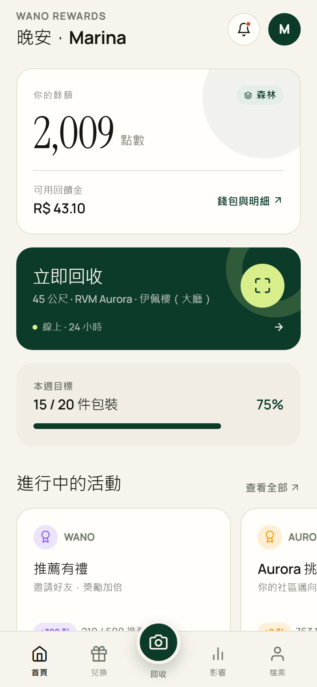
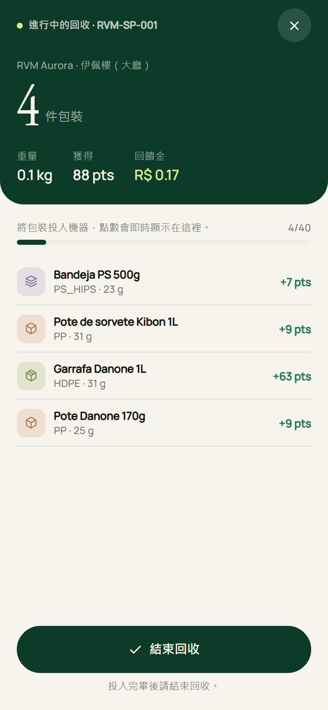
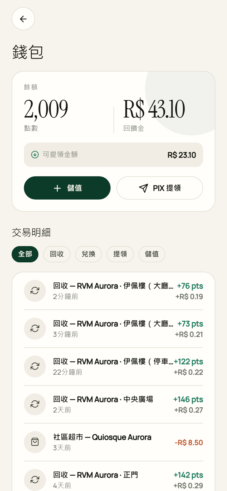
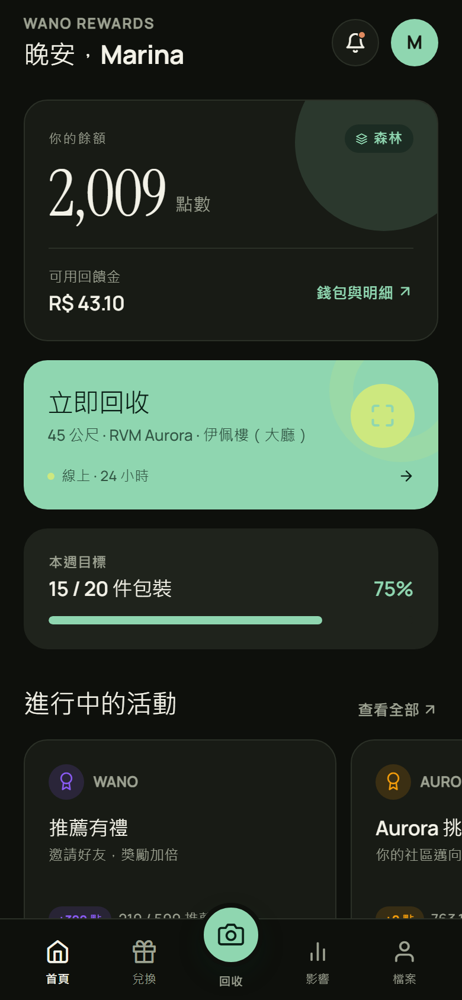
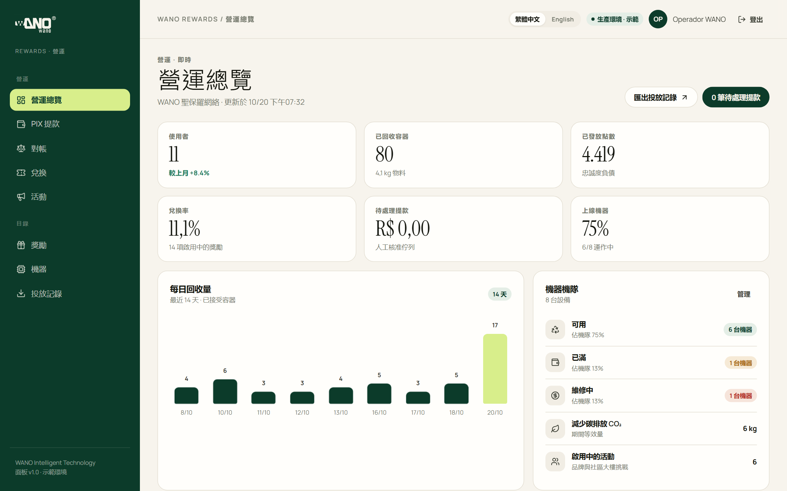
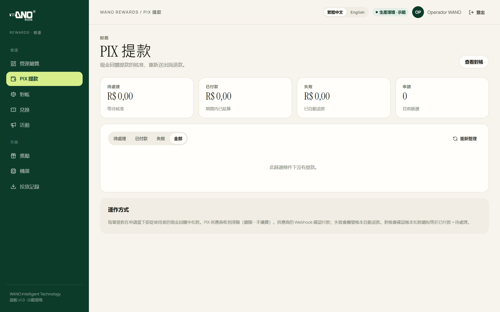
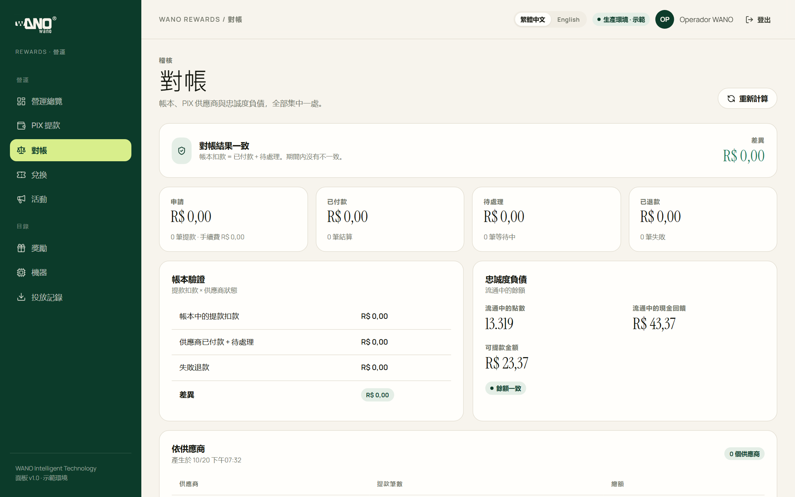
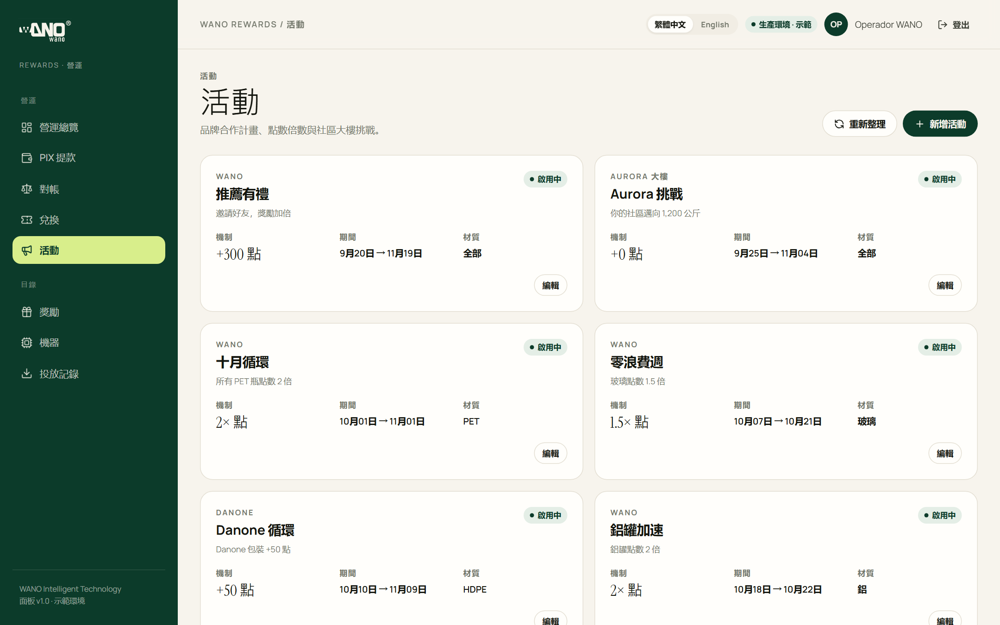
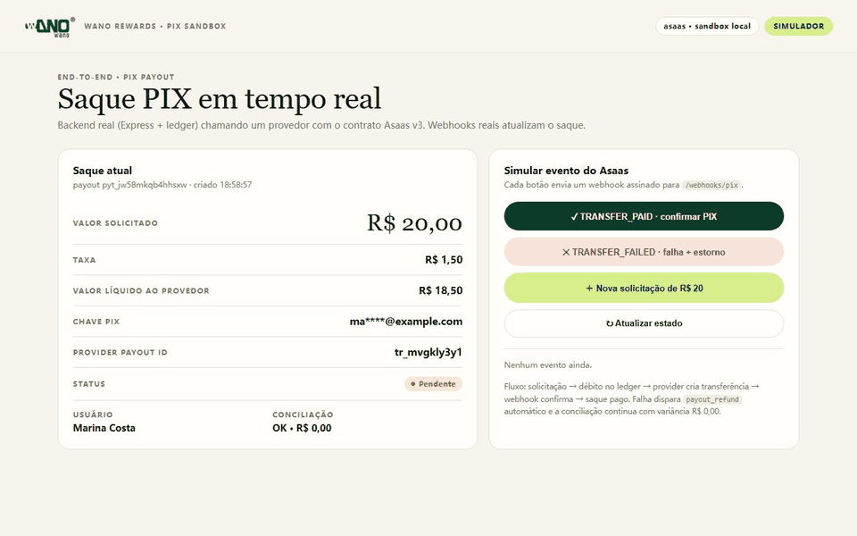

# WANO Rewards — RVM 回收积分 App + 运营后台（可部署）

面向 **Reverse Vending Machine（反向售货机 / 空瓶回收机）** 投瓶用户的积分与返现产品，由
**WANO Intelligent Technology** 运营。业务闭环：**扫码投瓶 → 积分 + 现金返现 → 兑换 / 迷你超市 / PIX 提现 → 品牌活动与公寓排行榜**。

> 不是通用积分商城：流程与字段对齐 `_inbox/RVM Requirements.txt` 中巴西 EK 1000 项目的
> §25–28（用户识别、积分返现、品牌赞助、迷你超市）与 §46–48（反欺诈、网络安全、LGPD）。

| 用户端首页 | 实时投瓶 | 钱包/支付 | 深色模式 |
| --- | --- | --- | --- |
|  |  |  |  |

| 运营后台 · 概览 | PIX 审核 | 对账 | 活动管理 |
| --- | --- | --- | --- |
|  |  |  |  |

## PIX 沙箱端到端演示



真实后端代码（Asaas v3 adapter + Webhook + ledger）跑通：待审 → TRANSFER_FAILED 自动退款 → 重新发起 → TRANSFER_PAID 已支付 → 对账 R$ 0,00。
本机无 Asaas 凭证，使用协议兼容的本地模拟器；替换 ASAAS_API_KEY 等环境变量即可切真实沙箱。详见 [demo 说明](docs/demo/README-zh.md)。
全部截图：用户端 [`docs/screenshots/`](docs/screenshots)（24 张繁體中文，真实 API 数据；英文版在 [`en/`](docs/screenshots/en)）+
后台 [`docs/screenshots/admin/`](docs/screenshots/admin)（9 张；英文版在 [`en/`](docs/screenshots/admin/en)）。

---

## 1. 交付内容

| 模块 | 路径 | 技术栈 | 状态 |
| --- | --- | --- | --- |
| 移动端 App | [`apps/mobile`](apps/mobile) | Expo SDK 58 · React Native 0.88 · Expo Router · TS | iOS / Android / Web 可跑 |
| 后端 API | [`apps/api`](apps/api) | Node 24 · Express 5 · `node:sqlite` · Stripe · PIX 抽象 | 测试全覆盖 |
| 运营后台 | [`apps/admin`](apps/admin) | Vite 8 · React 19 · TypeScript · 自绘设计系统 | 静态可部署 |
| 中文 PRD | [`docs/PRD-zh.md`](docs/PRD-zh.md) | 22 条 FR、24 埋点、12 风险 | 已完成 |
| API 契约 | [`docs/api-contract.md`](docs/api-contract.md) | — | 已实现 |
| 部署指南 | [`docs/DEPLOY-zh.md`](docs/DEPLOY-zh.md) | Docker / Render / Vercel / EAS | 已完成 |
| 验收脚本 | [`tools/verify-api.mjs`](tools/verify-api.mjs) | Node fetch | 30 项端到端 |
| 截图流水线 | [`tools/screenshot.mjs`](tools/screenshot.mjs) · [`tools/admin-screenshot.mjs`](tools/admin-screenshot.mjs) | Chrome headless | 33 张 |

## 2. 功能

**用户端（已实现）**

- 无密码 OTP 登录、JWT + 刷新令牌轮换；LGPD 同意、导出、注销（30 天宽限 + 假名化）。
- RVM 扫码 / 手输码开启会话；实时投瓶明细、重量、积分、返现、CO₂；会话收据。
- **双账本**：积分与现金返现分账，`credit` / `withdrawable` 独立；不可变流水 + 幂等键 + `balance_after_*` 快照。
- 等级（Seed/Sprout/Forest/Guardian）、奖励商城（券/实物/体验/捐赠）、兑换码 + 二维码、核销与过期。
- 品牌活动、公寓/楼栋/城市排行榜、连续投瓶、影响力徽章。
- **支付**：Stripe 测试模式 Checkout 充值（无密钥自动 mock，不产生真实扣款）；PIX 提现（最低 R$20、日限额、费率）。
- 迷你超市支付码、邀请裂变、通知中心、附近机器、深色模式、pt-BR + en、无障碍标签。

**运营后台（已实现）**

- 概览：用户、收集量、积分发行、兑换率、待审提现、机器在线率、14 日收集图、兑换动态。
- **PIX 队列**：批准、失败重试、人工失败（自动退款）；对账页展示 ledger×provider 差异、在途负债。
- 兑换履约、活动 CRUD、奖励 CRUD、机器占用率与优先采集、押金/回收 CSV 导出。
- 后台登录校验 JWT `role=admin`；与 App 同一设计语言（WANO 品牌）。

**后端平台能力**

- 管理端 API：KPI、CSV、活动/奖励 CRUD、履约、料箱、提现与对账、审计日志。
- PIX provider 抽象：`mock`（默认）与 `asaas` 沙箱适配器；Webhook 验签、幂等、失败退款、重试。
- 整机对接：`POST /ingest/deposits`（`X-Machine-Key`，按 eventId 幂等）。
- Stripe Webhook 验签/去重/退款冲正；SQLite WAL 单节点 + 持久卷；Postgres 迁移路径。

**明确未做**

- 真实资金出款通道需巴西本地 PSP 合同与 KYC/AML；当前 Asaas 适配器为沙箱实现，mock 为默认。
- 整机 HMI、回收商端、广告投放后台、应用商店素材与审核、正式税务/法律意见。

## 3. 5 分钟跑起来

前置：Node.js **24+**（`node:sqlite` 内置）、npm。

```powershell
# 1) API
cd apps/api
npm install
npm run seed
npm run dev            # http://localhost:8787/api/v1

# 2) 用户端
cd apps/mobile
npm install
copy .env.example .env # EXPO_PUBLIC_API_URL=http://localhost:8787/api/v1
npm start              # Expo Go / w 打开 Web

# 3) 运营后台
cd apps/admin
npm install
copy .env.example .env # 同上
npm run dev            # http://127.0.0.1:5174
```

**演示账号**（`AUTH_DEV_MODE=true`，验证码固定 `123456`）

| 角色 | 手机号 | 用途 |
| --- | --- | --- |
| 用户 | `+55 11 99999-0000` | Marina Costa · 1.860 pts · R$42,70（可提 R$22,70） |
| 管理员 | `+55 11 98888-0000` | 运营后台、提现审核、活动配置 |
| 合作方 | `+55 11 97777-0000` | 迷你超市收银核销 |

不配置 `EXPO_PUBLIC_API_URL` / `VITE_API_URL` 时，App 与后台均进入 **demo 模式**，内置 mock 数据可离线演示。

## 4. 验证结果

```text
API:   npm run typecheck ✅   npm run build ✅   npm test → 9 文件 / 39 测试 ✅
集成:  node tools/verify-api.mjs → 30/30 ✅（登录、投瓶、兑换幂等、充值、PIX 提现含手续费、管理员队列、对账、LGPD）
提现:  mock 出款 + webhook 失败退款 + 重试 + 对账 variance=0（见 API README 与测试）
App:   tsc ✅   expo export ✅   24 张真实 API 截图，无控制台错误
后台:  tsc ✅   vite build ✅   9 张截图（真实 API 数据），无控制台错误
```

## 5. 目录

```text
wano-rewards/
├─ apps/
│  ├─ api/       Express + SQLite；pix/ provider 抽象、对账、Docker、测试、README
│  ├─ mobile/    Expo App；app/ 路由、src/ 设计系统与数据层、eas.json
│  └─ admin/     运营后台；Vite + React、Dockerfile + nginx、README
├─ docs/         PRD、API 契约、部署指南、截图（用户端 + admin）
├─ tools/        verify-api / screenshot / admin-screenshot / 图标生成
└─ package.json  便捷脚本
```

## 6. 关键设计

- **巴西无押金模式**：没有退瓶费，必须靠积分 + 返现 + 品牌预算驱动复投；积分与现金分账，避免营销负债被当成可提现余额。
- **资金正确性**：所有余额变动单一账本、事务内加锁、幂等键唯一、余额快照；提现与对账以 ledger 为准。
- **反欺诈**：GTIN/形状/材质/重量校验、重复投瓶、提现限额与冷却、设备/行为异常审核位。
- **LGPD by design**：身份与回收数据匿名 ID 分离；导出/删除 SLA；跨境访问 SCC + TIA。
- **可部署优先**：单容器 + 持久卷即可试点；后台纯静态；规模上 1000 台再迁 Postgres/托管队列。

## 7. 上线前必须替换

1. `JWT_SECRET`、`AUTH_DEV_MODE=false`、`AUTO_SEED=false`、`DEMO_MODE=false`。
2. `EXPO_PUBLIC_API_URL` / `VITE_API_URL` 指向 HTTPS API；正式包名与签名。
3. Stripe 正式密钥 + Webhook；`PIX_PROVIDER=asaas` + Asaas 凭证 + Webhook token（或替换为其他本地 PSP）。
4. `CORS_ORIGINS` 白名单、日志脱敏、备份、监控告警。
5. 巴西法律意见：SPA 授权、IRRF、CDC、ANPD 通报、数据保留期。

详见 [部署指南](docs/DEPLOY-zh.md) 与 [PRD 风险](docs/PRD-zh.md)。

> 品牌说明：**WANO Rewards** 为产品名，**RecIO 1000** 为整机型号，运营主体为 WANO Intelligent Technology。
> 后端包名/数据库/API 前缀保留 `recio` 仅为兼容既有部署，不影响对外品牌。


